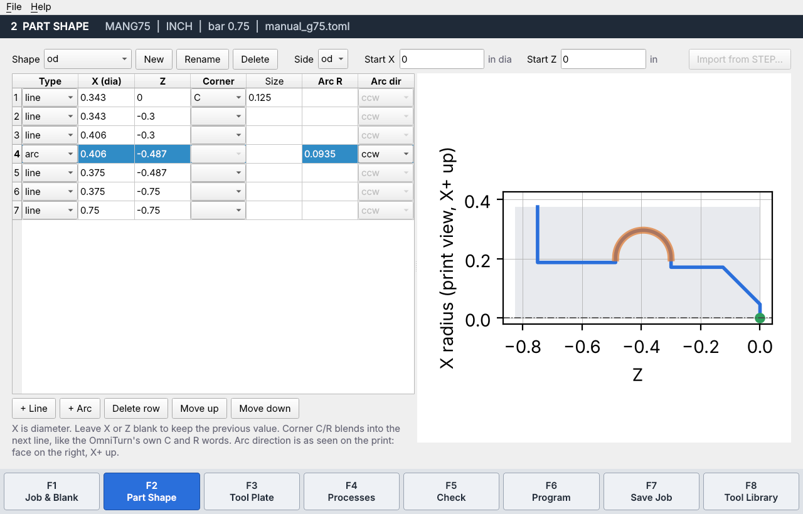
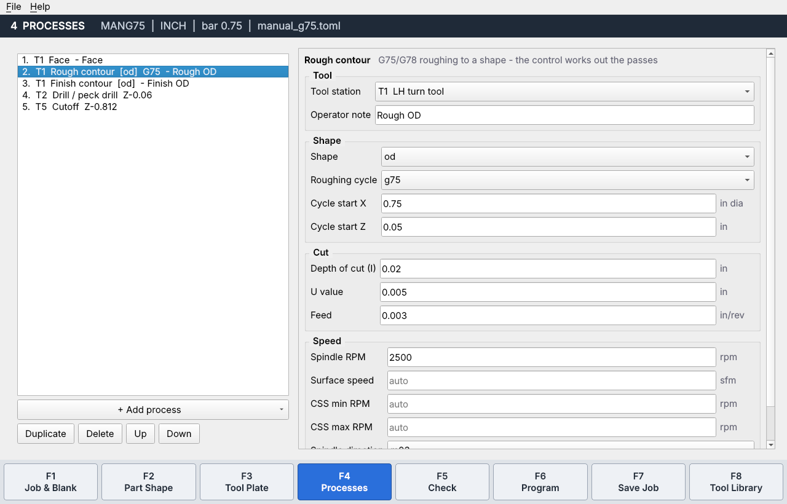
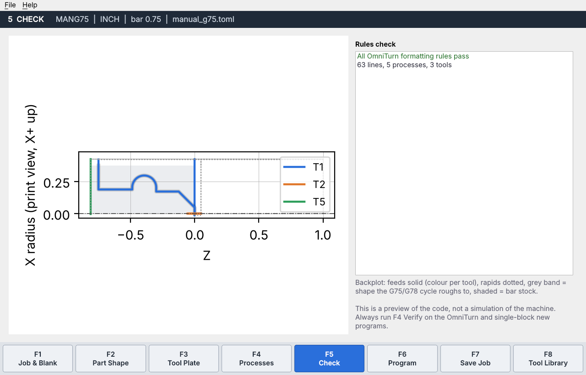
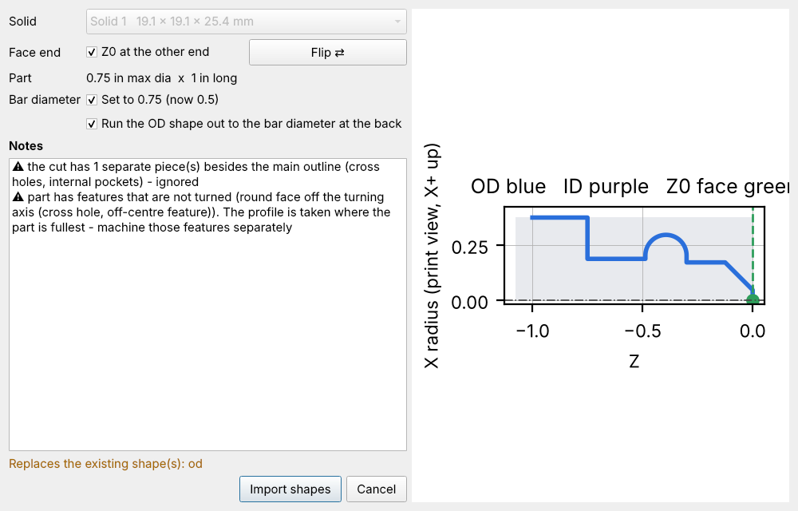

# omniturn-cam

Conversational 2D lathe CAM for **OmniTurn** gang-tool CNC lathes (G4 control).
Developed on a Hardinge HLV-H retrofitted with the OmniTurn G4 control and CNC
package. Machine limits (max rpm, collet capacity, safe Z) are set in a
`machine.toml` profile, so other OmniTurn machines and retrofits can use it too.
Describe the part and the operations, fill-in-the-blank style, and get a program
the OmniTurn will load from a USB stick. The goal is to take a STEP model of a
turned part, pull its profile out automatically, and generate the program.

> ⚠️ **Prove out every program.** This software writes code that moves a
> machine. Run new programs on the F4 Verify screen, then single-block with the
> feed override turned down. It comes with NO WARRANTY (see LICENSE).

## How it works

The OmniTurn control already does most of the CAM work. It has contour roughing
cycles (G75 / G78) that take a finish contour as a subroutine and work out the
roughing passes themselves, plus tool nose radius comp and automatic
chamfers and radii. So omniturn-cam focuses on:

1. **Profile** – the half-section of the part as lines and arcs in X (diameter) / Z.
   Typed in now; extracted from STEP in phase 3.
2. **Job** – stock, which tool is at which T number, and an ordered list of
   operations (face, rough, finish, drill, axial pass, radial pass, cutoff).
3. **Post** – writes the program following the manual's formatting rules
   (no N numbers, no commas, two-digit G/M codes, X and Z after every tool call…)
   and checks the output with a built-in linter.

Arcs are entered as they look on the print (face on the right, X+ up). The post
converts them to the OmniTurn's G02/G03, whose X axis points down.

## Status

| Phase | What | State |
|---|---|---|
| 1 | Profile model, OmniTurn post, rules linter, backplot, tool library, TOML jobs | **working** |
| 2 | Fill-in-the-blank GUI (Okuma IGF style), tool library editor | **working** |
| 2b | Drawing STEP/DXF tool models in the backplot | planned |
| 3 | STEP import: find the turning axis, cut the half-section, build OD and ID shapes | **working** |
| 4 | G33 threading (single/multi-start, angle infeed, pull-out, spring passes) | **working** |
| 5 | Collision checks against tool models, travel limits | planned |

## Install (Linux)

Step-by-step shop instructions: [SHOP-INSTALL.md](SHOP-INSTALL.md).

```bash
git clone https://github.com/legacybending-maker/omniture-CNC-program-maker
cd omniture-CNC-program-maker
python3 -m venv .venv && . .venv/bin/activate
pip install -e ".[all,dev]"          # GUI + STEP import (OpenCascade) + tests
omniturn-cam-gui                      # or: omniturn-cam gui examples/manual_g75.toml
```

## The programming screens

Like Okuma's IGF, you work through numbered steps with function keys along
the bottom:

| Key | Screen | What you fill in |
|---|---|---|
| F1 | Job & Blank | program name (8 chars max, becomes the file name), units, bar diameter, existing bore, a subroutine file to copy in below M30 (e.g. ZipLoader subs) |
| F2 | Part Shape | the contour as a table of lines and arcs, with a live preview |
| F3 | Tool Plate | which library tool sits at which T number, and its D offset for nose radius comp |
| F4 | Processes | face, box rough (G74), rough (G75/G78), finish, drill/peck, thread (G33), tap / solid die, axial pass (box tool, releasing die head), radial pass, cutoff, call subroutine (M98), raw program lines |
| F5 | Check | backplot of the generated code plus the OmniTurn rules check |
| F6 | Program | the program text, **Save to USB stick** (writes `NAME.cnc` with DOS line endings) |
| F7 | Save job | saves the job as a `.toml` file you can reopen and edit |
| F8 | Tool library | add or edit tools, including screw-machine tooling |

When you add a process it picks a suitable tool from the plate and fills in
values from that tool's parameters. A die head with `pitch = 0.05` gives a
spindle-synced axial pass at .05 IPR.





Your tool library lives in `~/.config/omniturn-cam/tools.toml`. A starter
library is copied there the first time the program runs.

## Importing a STEP file

On **F2 Part Shape**, press **Import from STEP…** and pick the file.

1. If the file has several solids (an assembly), choose one. You can also
   break a single part out of an assembly in FreeCAD and export just that
   body (File → Export → STEP).
2. The turning axis is found automatically, however the part sits in the
   model.
3. Check which end is the face (Z0) in the preview. Press **Flip** if it's
   the wrong end.
4. The OD becomes the shape `od`, and any bore or drilled hole becomes `id`.
   The OD is run out to the bar diameter at the back so G75/G78 have a
   closed area to rough. If the part is bigger than the bar set on F1, the
   bar size can be updated in the same step.

Flats, cross holes, hex and other features that aren't turned are listed
as notes. The shape is taken from the cut where the part is fullest, so
those features need their own operations. Fillets and arcs come in as arcs.
Chamfers come in as plain lines, not C words; the program is the same.



From the command line:

```bash
omniturn-cam step part.step --flip --stock 0.75              # prints the shapes as TOML
omniturn-cam step part.step --flip --into myjob.toml         # adds them to a job file
```

## Command line

```bash
omniturn-cam post examples/manual_g75.toml --tools examples/tools.toml --plot out.png
omniturn-cam lint MANG75.cnc       # works on hand-written programs too
pytest
```

## Files

- `examples/tools.toml` – tool library. Screw-machine tooling (box tools,
  straddle knurls, die heads) are their own tool kinds. Each tool has an
  orientation: radial, axial, or perpendicular to the plate. A tool can point
  at a STEP/DXF model of itself.
- `examples/manual_g75.toml` – the manual's G75 example as a full job.
- `docs/omniturn-post-rules.md` – every formatting rule the post follows, with
  manual page references and the items still to verify on a machine.

## Things to verify on a real machine

Please open an issue with what your machine does:

- X and Z travel for your machine (set `x_travel` / `z_travel` in machine.toml)
- G33 on firmware older than the 2023 manual

## License

GPL-3.0-or-later. Free to use, modify and share; derivatives must stay open.
The OmniTurn manual is © OmniTurn and is not included. Get it from omniturn.com.
OmniTurn is a trademark of its owner; this project is not affiliated with it.
